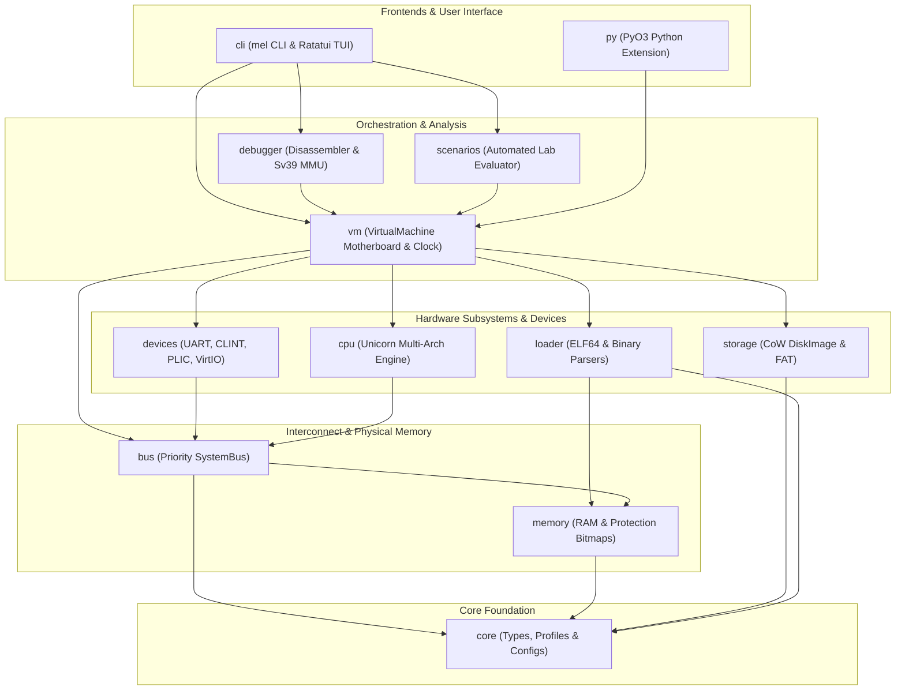

<p align="center">
  
</p>

# MEL

<div align="center">

[](https://www.rust-lang.org/)
[](https://blog.rust-lang.org/)
[](LICENSE)
[](#supported-cpu-architectures)
[](https://www.unicorn-engine.org/)
[](https://ratatui.rs)
[](python/)
[](scenarios/)

</div>

> **"Do not simulate the appearance of systems engineering. Simulate the systems."**

**MEL** is a bare-metal systems engineering simulator and interactive operating system laboratory. Built for developers, kernel hackers, and computer architecture enthusiasts, MEL lets you build, configure, understand, and debug the entire low-level software stack from first principles: from raw CPU reset vectors and MMIO device drivers to hardware timers, page tables, preemptive multitasking, and filesystems.

---

## Key Highlights

- **Real Hardware Emulation**: Executes native machine instructions on authentic CPU emulation engines (`unicorn-engine`) across **RISC-V 64**, **ARM64 (AArch64)**, **x86-64**, and **Power ISA 64 (PPC64)**.
- **Unified Interconnect & Hardware Peripherals**:
  - **NS16550 UART**: Bidirectional serial communication with standard register layouts (RBR/THR, IER, IIR/FCR, LCR, LSR, DLAB baud divisor latches).
  - **SiFive CLINT**: Hardware timer and software interrupt controller with deterministic cycle-synchronization.
  - **SiFive PLIC**: Platform-level interrupt controller managing 32 prioritizable interrupt sources and claim/complete workflows.
  - **VirtIO Block Device**: Virtual persistent block storage with 512-byte sector operations.
  - **Hardware Boot ROM**: Protected read/execute firmware space for power-on reset handoffs.
- **Copy-on-Write Block Storage & FAT Filesystem**: Non-destructive `DiskImage` backing with in-memory CoW overlays, transactional commits/rollbacks, and automated FAT12/FAT16/FAT32 image generation and file injection.
- **Sv39 MMU Hardware Page Table Walker**: Complete 3-level Sv39 virtual memory translation (4 KB base pages, 2 MB megapages, 1 GB gigapages) with flag auditing (`V`, `R`, `W`, `X`, `U`, `G`, `A`, `D`).
- **Interactive 4-Quadrant Ratatui Terminal UI Dashboard**:
  - Live **Disassembly View** with instruction-pointer centering and Capstone decoding.
  - **Register View** with dynamic delta color highlighting on modifications.
  - **Memory Hex Viewer** with real-time ASCII dump, scrolling, and byte search.
  - **ANSI UART Serial Terminal** with interactive keystroke forwarding and VTE terminal emulation.
- **12 Progressive OS Lab Milestones**: Self-contained challenge definitions (`scenarios/`) with automated grading assertions testing each phase of an operating system kernel.
- **PyO3 Python Extension & Grading Harness**: First-class Python bindings (`mel_py`) and automated grading harness (`python/tools/runner.py`) for automated testing and scripting.
- **Modern Rust 2024 Edition**: Idiomatic, memory-safe codebase featuring stabilized `let` chains, `#![forbid(unsafe_code)]` in safe crates, and verified `read_unaligned` pointer safety.

---

## Architecture & Workspace Layout

MEL is organized as a unified Cargo workspace under **Rust 2024 Edition**, comprising 12 specialized member crates:



### Directory Structure

```text
mel/
├── Cargo.toml                  # Workspace manifest (Rust 2024 Edition)
├── guidedoc.md                 # Detailed System & Developer Guide
├── machines/                   # Declarative YAML machine profile definitions
│   ├── riscv64_virt.yaml
│   ├── arm64_virt.yaml
│   ├── x86_64_virt.yaml
│   └── ppc64_virt.yaml
├── scenarios/                  # 12 Progressive OS Lab challenge definitions
│   ├── 01_first_boot.yaml
│   ├── 02_uart_driver.yaml
│   └── ...
├── examples/                   # Standalone bare-metal assembly payloads
│   ├── riscv64/hello_uart/
│   ├── arm64/hello_uart/
│   ├── x86_64/hello_uart/
│   └── powerpc64/hello_uart/
├── python/                     # Python tooling, evaluation engine & tests
│   ├── tools/
│   │   ├── scenario_eval.py    # Pattern-matched objective assertion engine
│   │   └── runner.py           # Automated scenario test runner & CLI
│   └── tests/
│       └── test_scenario_eval.py
└── crates/
    ├── core/                   # Architecture enums, Address/Size types, YAML machine profiles
    ├── memory/                 # Physical RAM buffer, bounds checking, permission bitmaps
    ├── bus/                    # Priority SystemBus routing transactions to RAM or MMIO devices
    ├── cpu/                    # Unicorn backends for RISC-V 64, ARM64, x86-64, Power ISA 64
    ├── devices/                # NS16550 UART, SiFive CLINT, SiFive PLIC, Boot ROM, VirtIO Block
    ├── storage/                # Copy-on-Write DiskImage overlay & FatFs filesystem tools
    ├── loader/                 # Flat binary and ELF64 loader with symbol table extraction
    ├── debugger/               # Capstone disassembler, Sv39 MMU walker, breakpoints, REPL
    ├── scenarios/              # Scenario validator, test framework & Compiler Challenge codegen
    ├── vm/                     # VirtualMachine motherboard, deterministic VirtualClock, V2 snapshots
    ├── cli/                    # mel CLI binary & 4-Quadrant Ratatui interactive TUI visualizer
    └── py/                     # PyO3 Python C-extension bindings (mel_py)
```

---

## Supported CPU Architectures

| Architecture | Word Size | Endianness | Default RAM Base | Default Reset Vector |
| :--- | :--- | :--- | :--- | :--- |
| **RISC-V 64 (RV64GC)** | 64-bit | Little | `0x8000_0000` | `0x8000_0000` |
| **ARM64 (AArch64)** | 64-bit | Little | `0x4000_0000` | `0x4000_0000` |
| **x86-64 (AMD64)** | 64-bit | Little | `0x0010_0000` | `0x0010_0000` |
| **Power ISA 64 (PPC64)** | 64-bit | Big | `0x0000_0000` | `0x0000_0100` |

---

## Quickstart Guide

### 1. Prerequisites
- **Rust**: Version 1.85+ (compatible with Rust 2024 Edition).
- **Python**: Version 3.10+ (for Python tools and test runner).
- **C/Assembly Cross-Compilers** *(optional, for compiling new custom payloads)*:
  - `riscv64-unknown-elf-gcc` or `clang`
  - `aarch64-linux-gnu-gcc` or `clang`
  - `x86_64-linux-gnu-gcc` or `clang`
  - `powerpc64-linux-gnu-gcc` or `clang`

Verify your host toolchain using MEL's built-in diagnostic tool:
```bash
cargo run -p mel-cli -- doctor
```

### 2. Build the Workspace
```bash
# Build all 12 crates
cargo build --workspace

# Build optimized release binaries
cargo build --workspace --release
```

### 3. Run a Bare-Metal Sample Payload
Execute a pre-built RISC-V 64 UART hello world binary in headless mode:
```bash
cargo run -p mel-cli -- run examples/riscv64/hello_uart/boot.bin --arch riscv64 --cycles 100000
```
Output:
```text
[MEL] Starting virtual machine (riscv64)...
[MEL] Payload 'examples/riscv64/hello_uart/boot.bin' loaded (64 bytes at 0x80000000)
[MEL] Execution completed in 31 cycles.
Hello MEL RISC-V!
```

### 4. Launch the Interactive 4-Quadrant TUI Dashboard
Launch the visualizer to step instructions, view live register updates, inspect memory, and interact with the UART:
```bash
cargo run -p mel-cli -- debug examples/riscv64/hello_uart/boot.bin --arch riscv64 --tui
```

#### TUI Dashboard Controls
| Key | Action |
| :--- | :--- |
| **`F10`** | Step single instruction |
| **`F5`** | Continue execution until breakpoint or halt |
| **`F9`** | Toggle breakpoint at highlighted instruction |
| **`Tab`** | Cycle active quadrant focus |
| **`Up` / `Down`** | Scroll disassembly / memory viewer |
| **`PageUp` / `PageDown`** | Fast scroll active quadrant |
| **`/`** | Open text/byte search dialog |
| **`Ctrl+Q`** or **`Esc`** | Exit dashboard |

---

## OS Lab Milestones (12 Scenarios)

MEL provides 12 guided operating system development challenges:

```bash
# Evaluate all scenarios in the scenarios directory
cargo run -p mel-cli -- test-scenarios --dir scenarios/

# Evaluate a specific scenario with a compiled binary payload
python3 python/tools/runner.py --scenario scenarios/01_first_boot.yaml --binary my_kernel.bin
```

1. **[`01_first_boot.yaml`](scenarios/01_first_boot.yaml)**: Reset vector execution and stack pointer setup (`sp = 0x80010000`).
2. **[`02_uart_driver.yaml`](scenarios/02_uart_driver.yaml)**: Writing an NS16550 serial transmitter driver.
3. **[`03_timer_tick.yaml`](scenarios/03_timer_tick.yaml)**: Programming SiFive CLINT `mtimecmp` and handling timer interrupts.
4. **[`04_bootloader_handoff.yaml`](scenarios/04_bootloader_handoff.yaml)**: Copying kernel payloads from Boot ROM to RAM and branching.
5. **[`05_disk_sector_reader.yaml`](scenarios/05_disk_sector_reader.yaml)**: Reading disk sectors via the MMIO Virtual Block Device.
6. **[`06_page_tables.yaml`](scenarios/06_page_tables.yaml)**: Constructing 3-level Sv39 page tables and activating the MMU (`satp`).
7. **[`07_context_switch.yaml`](scenarios/07_context_switch.yaml)**: Saving and restoring Task Control Block (TCB) register state.
8. **[`08_preemptive_scheduler.yaml`](scenarios/08_preemptive_scheduler.yaml)**: Timer-driven preemptive round-robin task switching.
9. **[`09_user_mode.yaml`](scenarios/09_user_mode.yaml)**: Dropping to User Mode (U-mode) and handling `ecall` system calls.
10. **[`10_fat_driver.yaml`](scenarios/10_fat_driver.yaml)**: Traversing FAT directory clusters to read filesystem files.
11. **[`11_guest_shell.yaml`](scenarios/11_guest_shell.yaml)**: Interactive UART input polling and line command execution.
12. **[`12_in_kernel_elf_loader.yaml`](scenarios/12_in_kernel_elf_loader.yaml)**: In-kernel ELF64 parser and user-space program loader.

---

## Python Integration & Automated Grading

MEL includes Python bindings via [`crates/py`](crates/py) and an evaluation harness in [`python/tools/`](python/tools):

```python
import mel_py

# Instantiate a virtual machine for any supported architecture
vm = mel_py.VirtualMachine(arch="riscv64")

# Load binary and execute
vm.load_binary(b"\x13\x01\x01\x00", 0x8000_0000)
vm.step()

# Inspect system state
print("PC:", hex(vm.pc()))
print("SP:", hex(vm.read_reg("sp")))
print("UART Output:", vm.uart_output_string())
```

Run Python automated self-tests:
```bash
# Run runner self-test suite
python3 python/tools/runner.py --test

# Run unit tests
python3 -m unittest discover -s python/tests
```

---

## Testing & Quality Verification

Run the full verification suite across all 12 crates:

```bash
# 1. Typecheck under Rust 2024
cargo check --workspace --all-targets

# 2. Strict linter audit (0 warnings required)
cargo clippy --workspace --all-targets

# 3. Format check
cargo fmt --check

# 4. Master regression and unit tests (all 12 crates)
cargo test --workspace

# 5. Multi-architecture matrix execution test
cargo test -p mel-vm --test multi_arch_matrix
```

---

## Documentation

For the complete technical specification, peripheral register mappings, memory layouts, and step-by-step programming tutorials, see:
👉 **[`guidedoc.md`](guidedoc.md) — Comprehensive System & Developer Guide**

---

## License

This project is licensed under the **MIT License**. See [LICENSE](LICENSE) for details.
