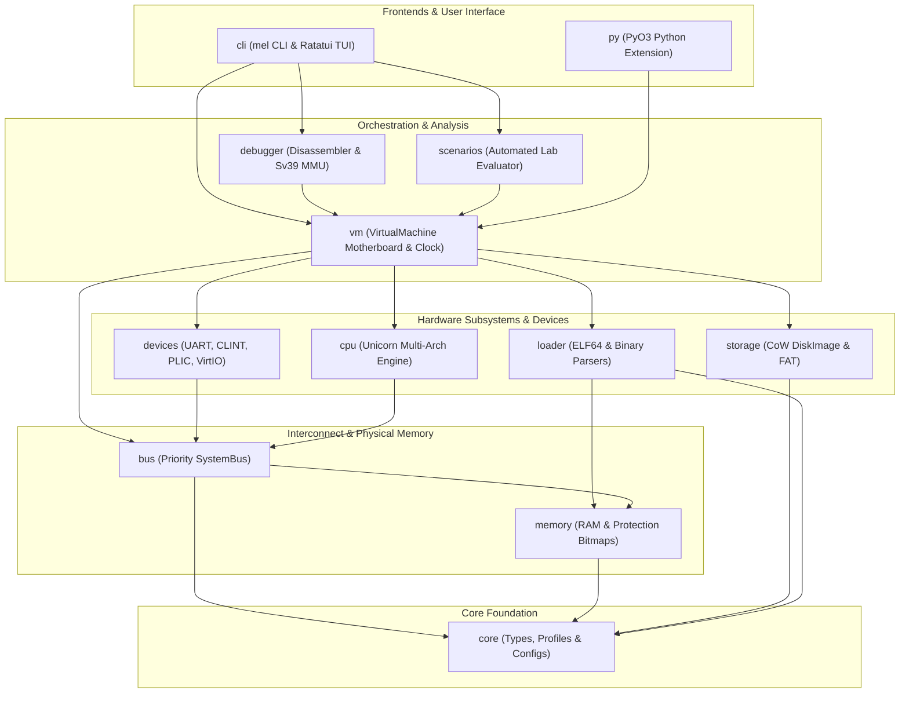
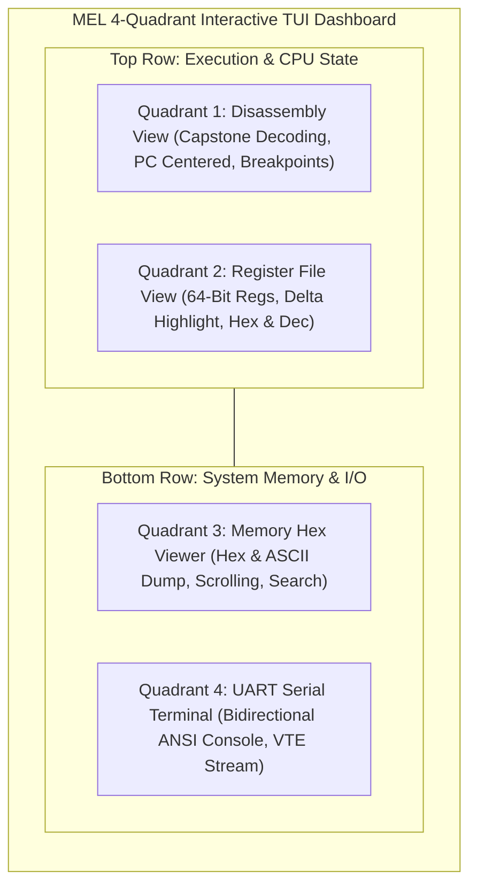
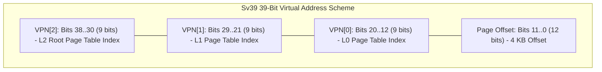
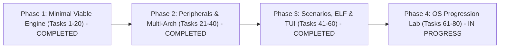

# MEL — Comprehensive System & Developer Guide

> **MEL** is a bare-metal systems-engineering simulation and operating system laboratory for developers and systems programmers.
> Developers start with a virtual machine built around real CPU architectures and progressively build, configure, understand, and replace the software stack required to make the machine useful: from first boot vectors and serial device drivers to interrupt controllers, page tables, preemptive multitasking, and virtual filesystems.

---

## Table of Contents

1. [Architecture Philosophy & Product Principles](#1-architecture-philosophy--product-principles)
2. [Workspace Architecture & 12-Crate System Graph](#2-workspace-architecture--12-crate-system-graph)
3. [Supported CPU Architectures & Memory Maps](#3-supported-cpu-architectures--memory-maps)
4. [Hardware Peripheral Subsystems](#4-hardware-peripheral-subsystems)
5. [Virtual Motherboard & Execution Engine (`vm`)](#5-virtual-motherboard--execution-engine-vm)
6. [ELF64 Binary Loading & Symbol Resolution (`loader`)](#6-elf64-binary-loading--symbol-resolution-loader)
7. [Debugger, Multi-Arch Disassembler & MMU Subsystem (`debugger`)](#7-debugger-multi-arch-disassembler--mmu-subsystem-debugger)
8. [Storage Subsystem & Copy-on-Write Filesystem (`storage`)](#8-storage-subsystem--copy-on-write-filesystem-storage)
9. [Scenarios Engine & 12 Guided OS Lab Milestones (`scenarios`)](#9-scenarios-engine--12-guided-os-lab-milestones-scenarios)
10. [CLI User Guide & 4-Quadrant Interactive TUI Dashboard (`cli`)](#10-cli-user-guide--4-quadrant-interactive-tui-dashboard-cli)
11. [Python Bindings & Automated Grading Harness (`py` & `python/`)](#11-python-bindings--automated-grading-harness-py--python)
12. [Bare-Metal Assembly Payloads Across 4 Architectures](#12-bare-metal-assembly-payloads-across-4-architectures)
13. [Getting Started & How to Code with MEL: Complete Hands-On Guide](#13-getting-started--how-to-code-with-mel-complete-hands-on-guide)
14. [Developer Guide, Testing Matrix & Rust 2024 Standards](#14-developer-guide-testing-matrix--rust-2024-standards)
15. [Milestone Progression & Roadmap](#15-milestone-progression--roadmap)

---

## 1. Architecture Philosophy & Product Principles

### 1.1 Core Principle
> **"Do not simulate the appearance of systems engineering. Simulate the systems."**

In MEL:
- If machine code is written, it executes on real hardware emulation backends (`unicorn-engine`).
- If a bootloader is written, the CPU physically jumps through its reset vector and executes each instruction.
- If stack pointers or memory mappings are configured incorrectly, the machine will crash or trigger architectural hardware traps.
- If a kernel, scheduler, or MMU page table is configured, the virtual motherboard enforces true architectural invariants.

### 1.2 Technology Reuse vs. Custom Architecture
MEL leverages mature, battle-tested open-source libraries where appropriate, while focusing core development on the simulation fabric:

| Subsystem | Underlying Technology | MEL Custom Layer |
| :--- | :--- | :--- |
| **CPU Emulation** | `unicorn-engine` 2.1 | [`cpu`](crates/cpu): Generic `CpuBackend` trait, register abstraction, MMIO bus hooking, Port I/O dispatching, trap handling |
| **Disassembly** | `capstone` 0.12 | [`debugger`](crates/debugger): Multi-architecture instruction decoding, formatted dumps, symbol resolution |
| **Filesystems** | `fatfs` 0.3.6 | [`storage`](crates/storage): Copy-on-Write RAM overlays, transactional disk backing, automated image formatting |
| **CLI & Parsing** | `clap` 4.5, `serde` 1.0 | [`cli`](crates/cli), [`core`](crates/core): Machine profiles, YAML configuration schemas, interactive REPL |
| **TUI Dashboard** | `ratatui` 0.28, `crossterm` 0.28, `vte` 0.13 | [`cli`](crates/cli): 4-quadrant responsive TUI, ANSI terminal emulation, memory hex viewer |
| **Motherboard & Bus** | Pure Rust 2024 ([`bus`](crates/bus), [`vm`](crates/vm)) | Priority device routing, RAM management, deterministic cycle clock, polymorphic snapshotting |
| **Python Bindings** | `pyo3` 0.22 | [`py`](crates/py): Native Python extension module, automated grading harness |

---

## 2. Workspace Architecture & 12-Crate System Graph

The MEL project is organized as a unified Cargo workspace under **Rust 2024 Edition**, comprising 12 specialized member crates:



### 2.1 Crate Breakdown

1. [`crates/core`](crates/core/src/lib.rs): Fundamental types ([`Address`](crates/core/src/types.rs#L6), [`Size`](crates/core/src/types.rs#L15), [`RegisterId`](crates/core/src/types.rs#L148)), architectural enumerations ([`Architecture`](crates/core/src/arch.rs#L10), [`Endianness`](crates/core/src/types.rs#L63)), standard memory maps ([`ArchitectureMemoryMap`](crates/core/src/memory_maps.rs)), and YAML profile models ([`MachineProfile`](crates/core/src/profile.rs#L52)).
2. [`crates/memory`](crates/memory/src/lib.rs): System physical RAM backing ([`Ram`](crates/memory/src/ram.rs#L8)), memory region permissions (`Read`, `Write`, `Execute`), and bounds checking.
3. [`crates/bus`](crates/bus/src/lib.rs): Unified [`SystemBus`](crates/bus/src/bus.rs#L46) interconnect routing reads and writes to RAM or mapped [`BusDevice`](crates/bus/src/device.rs#L6) MMIO peripherals.
4. [`crates/cpu`](crates/cpu/src/lib.rs): CPU execution backends implementing the `CpuBackend` trait for RISC-V 64 ([`Riscv64Cpu`](crates/cpu/src/riscv64.rs)), ARM64 ([`Arm64Cpu`](crates/cpu/src/arm64.rs)), x86-64 ([`X86_64Cpu`](crates/cpu/src/x86_64.rs)), Power ISA 64 ([`PowerIso64Cpu`](crates/cpu/src/powerpc64.rs)), and Mock testing CPUs.
5. [`crates/devices`](crates/devices/src/lib.rs): Hardware MMIO peripherals: NS16550 UART ([`Uart16550`](crates/devices/src/uart16550.rs)), SiFive CLINT ([`Clint`](crates/devices/src/clint.rs)), SiFive PLIC ([`Plic`](crates/devices/src/plic.rs)), Boot ROM ([`BootRom`](crates/devices/src/rom.rs)), and Virtual Block Device ([`VirtioBlock`](crates/devices/src/block.rs)).
6. [`crates/storage`](crates/storage/src/lib.rs): [`DiskImage`](crates/storage/src/disk.rs) virtual block storage backing, Copy-on-Write overlay engine, and [`FatFs`](crates/storage/src/fat.rs) filesystem manipulation.
7. [`crates/loader`](crates/loader/src/lib.rs): Flat binary payload loader, ELF64 header/segment loader, and symbol table extraction.
8. [`crates/debugger`](crates/debugger/src/lib.rs): Multi-arch Capstone disassembler, breakpoint/watchpoint management, register inspection, Sv39 MMU page table walker, and interactive REPL.
9. [`crates/scenarios`](crates/scenarios/src/lib.rs): Scenario definition schema, validation engine, automated evaluation runner, and the Compiler Challenge codegen suite.
10. [`crates/vm`](crates/vm/src/lib.rs): [`VirtualMachine`](crates/vm/src/machine.rs#L34) motherboard composing CPU, Bus, RAM, Peripherals, [`VirtualClock`](crates/vm/src/clock.rs#L12), and Version 2 Polymorphic Snapshots.
11. [`crates/cli`](crates/cli/src/lib.rs): Complete command-line interface providing `run`, `debug`, `inspect`, `machine`, `test-scenarios`, `doctor`, `docs`, and the 4-quadrant interactive TUI visualizer.
12. [`crates/py`](crates/py/src/lib.rs): PyO3 Python extension module providing `VirtualMachine` Python class bindings and integration for automated grading.

---

## 3. Supported CPU Architectures & Memory Maps

MEL provides authentic bare-metal execution across four distinct 64-bit CPU architectures:

| Architecture | Pointer Size | Endianness | RAM Base | Reset Vector |
| :--- | :--- | :--- | :--- | :--- |
| **RISC-V 64** | 64-bit | Little-Endian | `0x8000_0000` | `0x8000_0000` |
| **ARM64 (AArch64)** | 64-bit | Little-Endian | `0x4000_0000` | `0x4000_0000` |
| **x86-64** | 64-bit | Little-Endian | `0x0010_0000` | `0x0010_0000`* |
| **Power ISA 64** | 64-bit | Big-Endian | `0x0000_0000` | `0x0000_0100` |

*\* Default PC reset vector for flat binary payloads.*

### 3.1 RISC-V 64 (`riscv64_virt`)
- **Memory Map Layout**:
  - `0x0000_1000..0x0000_2000` (4 KB): Boot ROM (Read/Execute)
  - `0x0200_0000..0x0201_0000` (64 KB): SiFive CLINT (Core Local Interruptor)
  - `0x0C00_0000..0x1000_0000` (64 MB): SiFive PLIC (Platform-Level Interrupt Controller)
  - `0x1000_0000..0x1000_0100` (256 B): NS16550 UART (Serial Console)
  - `0x2000_0000..0x2000_1000` (4 KB): Virtual Block Storage Device
  - `0x8000_0000..0x8400_0000` (64 MB default): Main RAM (All permissions)

### 3.2 ARM64 (`arm64_virt`)
- **Memory Map Layout**:
  - `0x0000_0000..0x0001_0000` (64 KB): Boot ROM (Read/Execute)
  - `0x0800_0000..0x0801_0000` (64 KB): GIC (Generic Interrupt Controller)
  - `0x0900_0000..0x0900_0100` (256 B): NS16550 UART
  - `0x2000_0000..0x2000_1000` (4 KB): Virtual Block Storage Device
  - `0x4000_0000..0x4400_0000` (64 MB default): Main RAM

### 3.3 x86-64 (`x86_64_virt`)
- **Memory Map Layout**:
  - `0x000F_0000..0x0010_0000` (64 KB): System BIOS ROM
  - `0x0010_0000..0x0410_0000` (64 MB default): Conventional RAM
  - `0x1000_0000..0x1000_0100` (256 B): MMIO UART
  - Port I/O `0x03F8`: COM1 Serial Port mapping
  - `0x2000_0000..0x2000_1000` (4 KB): Virtual Block Storage Device
  - `0xFEE0_0000..0xFEE0_1000` (4 KB): Local APIC

### 3.4 Power ISA 64 (`ppc64_virt`)
- **Memory Map Layout**:
  - `0x0000_0000..0x0400_0000` (64 MB default): Main RAM (Reset vector at `0x0000_0100`)
  - `0x1000_0000..0x1000_0100` (256 B): NS16550 UART
  - `0x2000_0000..0x2000_1000` (4 KB): Virtual Block Storage Device

---

## 4. Hardware Peripheral Subsystems

### 4.1 NS16550 Compatible UART ([`crates/devices/src/uart16550.rs`](crates/devices/src/uart16550.rs))
Industry-standard 8-bit UART peripheral supporting:
- Register offsets:
  - `0x00`: RBR (Receiver Buffer, Read) / THR (Transmitter Holding, Write) / DLL (Divisor Latch Low, DLAB=1)
  - `0x01`: IER (Interrupt Enable Register) / DLM (Divisor Latch High, DLAB=1)
  - `0x02`: IIR (Interrupt Identification Register, Read) / FCR (FIFO Control Register, Write)
  - `0x03`: LCR (Line Control Register, bit 7 = DLAB)
  - `0x04`: MCR (Modem Control Register)
  - `0x05`: LSR (Line Status Register: bit 5 = THRE, bit 0 = DR)
  - `0x06`: MSR (Modem Status Register)
  - `0x07`: SCR (Scratchpad Register)
- Bidirectional buffering: `drain_output()` and `inject_input()` for interactive shell communication.

### 4.2 SiFive CLINT Timer ([`crates/devices/src/clint.rs`](crates/devices/src/clint.rs))
Standard RISC-V Core Local Interruptor:
- `0x0000`: `msip` (Machine Software Interrupt Pending) for hart 0
- `0x4000`: `mtimecmp` (64-bit Machine Timer Compare)
- `0xBFF8`: `mtime` (64-bit Real-Time Counter)
- Synchronized with `VirtualClock` cycle progression to deliver deterministic timer interrupts.

### 4.3 SiFive PLIC Interrupt Controller ([`crates/devices/src/plic.rs`](crates/devices/src/plic.rs))
Platform-Level Interrupt Controller managing priority arbitration:
- Priority registers for sources 1..32 (`0x000000..0x000080`)
- Pending bitmap (`0x001000`)
- Enable bits per context (`0x002000`)
- Priority threshold (`0x200000`) and Claim/Complete register (`0x200004`)

### 4.4 VirtIO Virtual Block Device ([`crates/devices/src/block.rs`](crates/devices/src/block.rs))
MMIO register interface for block storage:
- `0x00`: Magic value (`0x74726976`, `"virt"`)
- `0x04`: Version (`0x02`)
- `0x08`: Device ID (`0x02` for Block)
- `0x10`: Status register
- `0x20`: Sector index (64-bit)
- `0x28`: Command register (Read = 1, Write = 2, Flush = 3)
- `0x30`: Interrupt enable & pending status
- `0x100..0x300` (512 bytes): Data sector buffer window

---

## 5. Virtual Motherboard & Execution Engine (`vm`)

The [`VirtualMachine`](crates/vm/src/machine.rs#L34) struct brings together CPU execution, bus routing, physical memory, peripherals, and timing.

### 5.1 Deterministic Stepping & Cycle Synchronization
Execution advances using explicit cycle budgeting:
```rust
let step_result = vm.step()?;      // Single instruction execution
let run_result = vm.run(100_000)?; // Execute up to 100k cycles or trap/halt
```
The [`VirtualClock`](crates/vm/src/clock.rs#L12) advances deterministically (10 MHz default), driving timer ticks on SiFive CLINT and peripheral bus cycles.

### 5.2 Version 2 Polymorphic Snapshots ([`crates/vm/src/snapshot.rs`](crates/vm/src/snapshot.rs))
MEL supports saving and restoring complete machine execution states:
- Format header: Magic bytes `MELS`, Version `2`.
- Stores CPU registers, PC, RAM contents, UART buffers, Boot ROM state, peripheral devices, and virtual clock state.
- Cross-architecture validation prevents loading snapshots into mismatched CPU architectures.

---

## 6. ELF64 Binary Loading & Symbol Resolution (`loader`)

The [`loader`](crates/loader/src/lib.rs) crate supports both raw binary payloads and standard 64-bit ELF executables:

### 6.1 Features
- **ELF64 Format Parser**: Reads program headers (`PT_LOAD`), calculates entry points, and maps segments directly into guest virtual memory with proper permissions.
- **Symbol Table Extraction** ([`symbols.rs`](crates/loader/src/symbols.rs)): Extracts `.symtab` and `.strtab` to resolve symbol names, function boundaries, and code addresses for disassembly and debugger inspection.
- **Safe Memory Invariants**: Employs `std::ptr::read_unaligned` and verified buffer sizing to guarantee zero undefined behavior when inspecting unaligned ELF section headers.

---

## 7. Debugger, Multi-Arch Disassembler & MMU Subsystem (`debugger`)

The [`debugger`](crates/debugger/src/lib.rs) crate provides interactive systems analysis:

### 7.1 Capstone Multi-Architecture Disassembly
Dynamically decodes instructions across all 4 architectures with symbol annotation and formatting:
```text
0x80000000:  13 01 01 00     addi    sp, sp, 16
0x80000004:  73 00 00 00     ecall
```

### 7.2 Sv39 MMU Page Table Walker ([`crates/debugger/src/sv39.rs`](crates/debugger/src/sv39.rs))
Full hardware page table walker for RISC-V Sv39 virtual memory:
- Traverses 3-level page tables (Root L2 $\rightarrow$ L1 $\rightarrow$ L0 page table entries).
- Decodes Virtual Page Numbers (`VPN[2]`, `VPN[1]`, `VPN[0]`).
- Decodes entry flags: Valid (`V`), Read (`R`), Write (`W`), Execute (`X`), User (`U`), Global (`G`), Accessed (`A`), Dirty (`D`).
- Supports 4 KB base pages, 2 MB megapages, and 1 GB gigapages.

### 7.3 Interactive Debugger REPL
Commands available in the REPL:
- `step` / `s`: Step single instruction.
- `step <N>`: Step N instructions.
- `cont` / `c`: Continue execution until breakpoint or halt.
- `break <addr>` / `b`: Toggle breakpoint at address.
- `reg [name]`: Print all or specific register values.
- `read <addr> [len]` / `x`: Hexdump memory.
- `disasm [addr] [count]`: Disassemble instructions.
- `page <vaddr>`: Walk Sv39 page tables and translate virtual address.

---

## 8. Storage Subsystem & Copy-on-Write Filesystem (`storage`)

The [`storage`](crates/storage/src/lib.rs) crate manages persistent disk images:

### 8.1 Copy-on-Write RAM Overlays
- [`DiskImage`](crates/storage/src/disk.rs#L12) loads sector data into a base image while tracking modifications in an in-memory sparse overlay.
- Allows destructive testing and filesystem formatting without modifying host files.
- `commit()` flushes overlay sectors back to host storage.
- `discard()` rolls back modifications to pristine state.

### 8.2 FAT Filesystem Engine ([`crates/storage/src/fat.rs`](crates/storage/src/fat.rs))
- Fully automated FAT12/FAT16/FAT32 image generation.
- Programmatic file injection (`inject_file()`), extraction (`read_file()`), directory listing (`list_dir()`), and removal (`remove_file()`).

---

## 9. Scenarios Engine & 12 Guided OS Lab Milestones (`scenarios`)

The [`scenarios`](crates/scenarios/src/lib.rs) crate and [`scenarios/`](scenarios) directory define 12 sequential systems engineering challenges:

| # | Scenario YAML | Focus Area | Key Objectives |
| :- | :--- | :--- | :--- |
| **01** | [`01_first_boot.yaml`](scenarios/01_first_boot.yaml) | Reset & Stack | Initialize `sp = 0x80010000`, execute first instruction, no traps. |
| **02** | [`02_uart_driver.yaml`](scenarios/02_uart_driver.yaml) | Serial I/O | Program NS16550 THR register, output `"BOOT OK\n"`. |
| **03** | [`03_timer_tick.yaml`](scenarios/03_timer_tick.yaml) | Hardware Timer | Configure CLINT `mtimecmp`, enable `mie.MTIE`, handle timer interrupt. |
| **04** | [`04_bootloader_handoff.yaml`](scenarios/04_bootloader_handoff.yaml) | Boot ROM $\rightarrow$ RAM | Copy kernel payload from ROM to RAM, jump to RAM entry. |
| **05** | [`05_disk_sector_reader.yaml`](scenarios/05_disk_sector_reader.yaml) | Block Storage | Program MMIO block device, load sector 2 into RAM buffer. |
| **06** | [`06_page_tables.yaml`](scenarios/06_page_tables.yaml) | Virtual Memory | Construct Sv39 page tables, set `satp`, enable address translation. |
| **07** | [`07_context_switch.yaml`](scenarios/07_context_switch.yaml) | Task Context | Save registers to Task Control Block (TCB), restore second task. |
| **08** | [`08_preemptive_scheduler.yaml`](scenarios/08_preemptive_scheduler.yaml) | Multitasking | Preempt task A on timer tick, switch to task B, round-robin. |
| **09** | [`09_user_mode.yaml`](scenarios/09_user_mode.yaml) | Privilege Levels | Drop to User Mode (U-mode), invoke kernel via `ecall` syscall. |
| **10** | [`10_fat_driver.yaml`](scenarios/10_fat_driver.yaml) | File Reading | Parse FAT filesystem root directory, read `/boot/kernel.bin`. |
| **11** | [`11_guest_shell.yaml`](scenarios/11_guest_shell.yaml) | Interactive Shell | Read UART RBR input, echo characters, execute `help` / `uname`. |
| **12** | [`12_in_kernel_elf_loader.yaml`](scenarios/12_in_kernel_elf_loader.yaml) | Binary Loading | Load user-space ELF binary from disk into process memory and execute. |

### 9.1 Automated Grading & Evaluator
The scenario harness grades execution traces against assertions:
- `register_equals`, `register_in_range`
- `memory_contains`
- `uart_output_contains`, `uart_output_exact`
- `cycles_under`, `no_traps`, `program_counter_equals`

---

## 10. CLI User Guide & 4-Quadrant Interactive TUI Dashboard (`cli`)

The [`mel`](crates/cli) executable provides subcommands for running, inspecting, and debugging:

```bash
# Run a binary payload in headless mode
cargo run -p mel-cli -- run payload.bin --arch riscv64 --cycles 100000

# Inspect architectural memory map and peripheral layout
cargo run -p mel-cli -- inspect payload.bin --arch riscv64

# Launch interactive CLI REPL debugger
cargo run -p mel-cli -- debug payload.bin --arch riscv64

# Launch the 4-Quadrant Ratatui Terminal UI Dashboard
cargo run -p mel-cli -- debug payload.bin --arch riscv64 --tui

# Evaluate scenario challenge suite
cargo run -p mel-cli -- test-scenarios --dir scenarios/

# Check cross-compiler toolchain availability
cargo run -p mel-cli -- doctor

# Export markdown documentation for all architectures
cargo run -p mel-cli -- docs --output docs/
```

### 10.1 The 4-Quadrant Interactive TUI Visualizer
When launched with `--tui`, `mel` provides an interactive dashboard:



#### Keyboard Controls:
- **`F10`**: Step single instruction.
- **`F5`**: Continue execution until breakpoint or trap.
- **`F9`**: Toggle breakpoint at currently highlighted instruction.
- **`Tab`**: Switch focus between quadrants (Disassembly, Registers, Memory, UART).
- **`Ctrl+Q`** or **`Esc`**: Exit visualizer.
- **`Up` / `Down` / `PageUp` / `PageDown`**: Scroll active quadrant.
- **`/`**: Search in Memory or Disassembly view.

---

## 11. Python Bindings & Automated Grading Harness (`py` & `python/`)

MEL provides first-class Python integration via PyO3:

### 11.1 Native Extension Module (`mel_py`)
Located in [`crates/py`](crates/py):
```python
import mel_py

# Create VM for target architecture
vm = mel_py.VirtualMachine(arch="riscv64")

# Load raw binary and step
vm.load_binary(b"\x13\x01\x01\x00", 0x8000_0000)
vm.step()

# Inspect registers and memory
sp = vm.read_reg("sp")
mem_bytes = vm.read_mem(0x8000_0000, 4)
uart_output = vm.uart_output_string()
```

### 11.2 Python Grading Harness (`python/tools/`)
- [`scenario_eval.py`](python/tools/scenario_eval.py): Objective evaluation engine utilizing `@dataclass(slots=True)`, `match / case` pattern matching, and keyword-only API contracts.
- [`runner.py`](python/tools/runner.py): CLI grading harness supporting `--test`, `--scenario`, `--binary`, and `--json`.
- [`tests/test_scenario_eval.py`](python/tests/test_scenario_eval.py): Unit test suite verifying all 8 objective types and runner execution.

---

## 12. Bare-Metal Assembly Payloads Across 4 Architectures

MEL includes functional, tested assembly boot samples for each architecture in [`examples/`](examples):

### 12.1 RISC-V 64 (`examples/riscv64/hello_uart/`)
Initializes stack, configures UART THR pointer, and prints `"Hello MEL RISC-V!\n"`:
```assembly
.section .text.boot, "ax", @progbits
.globl _start

_start:
    lui     sp, 0x80010          # sp = 0x80010000
    lui     s0, 0x10000          # s0 = UART base 0x10000000
    lla     s1, msg

print_loop:
    lbu     t0, 0(s1)
    beqz    t0, halt_loop
    sb      t0, 0(s0)            # Write byte to UART THR
    addi    s1, s1, 1
    j       print_loop

halt_loop:
    wfi
    j       halt_loop

.section .rodata
msg:
    .string "Hello MEL RISC-V!\n"
```

### 12.2 ARM64 (`examples/arm64/hello_uart/`)
Sets SP to `0x4001_0000`, loads UART base `0x0900_0000`, and streams `"Hello MEL ARM64!\n"`:
```assembly
.section .text.boot, "ax", @progbits
.globl _start

_start:
    mov     x0, #0x40000000
    movk    x0, #0x4001, lsl #16
    mov     sp, x0
    mov     x1, #0x09000000      # ARM64 UART base
    adr     x2, msg

print_loop:
    ldrb    w3, [x2], #1
    cbz     w3, halt_loop
    strb    w3, [x1]
    b       print_loop

halt_loop:
    wfi
    b       halt_loop

.section .rodata
msg:
    .asciz "Hello MEL ARM64!\n"
```

### 12.3 x86-64 (`examples/x86_64/hello_uart/`)
Sets stack pointer, uses RIP-relative addressing, and writes to MMIO UART `0x1000_0000`:
```assembly
.section .text.boot, "ax", @progbits
.globl _start

_start:
    movq    $0x00200000, %rsp
    movabsq $0x10000000, %rdi    # UART base
    leaq    msg(%rip), %rsi

print_loop:
    movzbq  (%rsi), %rax
    testb   %al, %al
    jz      halt_loop
    movb    %al, (%rdi)
    incq    %rsi
    jmp     print_loop

halt_loop:
    pause
    jmp     halt_loop

.section .rodata
msg:
    .asciz "Hello MEL x86-64!\n"
```

### 12.4 Power ISA (`examples/powerpc64/hello_uart/`)
Sets R1 stack pointer, loads big-endian addresses, and writes to UART:
```assembly
.section .text.boot, "ax", @progbits
.globl _start

_start:
    lis     1, 1
    ori     1, 1, 0              # R1 stack pointer = 0x00010000
    lis     3, 0x1000
    ori     3, 3, 0              # R3 = 0x10000000 (UART base)
    lis     4, msg@ha
    addi    4, 4, msg@l

print_loop:
    lbz     5, 0(4)
    cmpwi   5, 0
    beq     halt_loop
    stb     5, 0(3)
    addi    4, 4, 1
    b       print_loop

halt_loop:
    b       halt_loop

.section .rodata
msg:
    .string "Hello MEL PowerPC!\n"
```

---

## 13. Getting Started & How to Code with MEL: Complete Hands-On Guide

This section is a comprehensive step-by-step developer tutorial that guides you from a fresh clone to writing, assembling, loading, debugging, and testing your own custom bare-metal programs and operating system components.

### 13.1 Developer Setup & Toolchain Verification

#### Step 1: Install Rust 2024 Toolchain
MEL requires Rust 1.85+ to support the Rust 2024 edition and stabilized `let` chains:
```bash
rustup update stable
rustc --version
```

#### Step 2: Install Cross-Compilers (Optional for Custom Payloads)
To compile custom assembly or C programs into bare-metal payloads for different architectures, install the appropriate GNU or LLVM toolchain:
- **Ubuntu/Debian**:
  ```bash
  sudo apt-get install gcc-riscv64-unknown-elf gcc-aarch64-linux-gnu gcc-x86-64-linux-gnu gcc-powerpc64-linux-gnu clang lld
  ```
- **Arch Linux**:
  ```bash
  sudo pacman -S riscv64-elf-gcc aarch64-linux-gnu-gcc clang lld
  ```
- **macOS (Homebrew)**:
  ```bash
  brew tap riscv/riscv
  brew install riscv-gnu-toolchain llvm
  ```

#### Step 3: Run the Environment Diagnostic Doctor
MEL includes a built-in doctor subcommand that inspects your host machine and reports installed cross-compilers:
```bash
cargo run -p mel-cli -- doctor
```

---

### 13.2 The MEL Bare-Metal Programming Mental Model

When writing code for MEL, you are writing code for a bare computer without an existing operating system. There is:
- **No `printf` or standard library**: You write directly to MMIO hardware registers.
- **No initial stack pointer**: Your very first instructions must initialize the stack pointer register (`sp` / `rsp` / `r1`) before calling any functions.
- **No virtual memory by default**: All addresses are physical memory addresses until you configure and enable page tables in the CPU.
- **Strict Reset Vector**: When the virtual machine powers on, the CPU's Program Counter (`PC`) starts at the hardware reset vector:
  - **RISC-V 64**: Starts at `0x8000_0000` (RAM base).
  - **ARM64**: Starts at `0x4000_0000` (RAM base).
  - **x86-64**: Starts at `0x0010_0000` (Conventional 1 MB RAM base).
  - **Power ISA 64**: Starts at `0x0000_0100` (Standard PPC reset vector).

---

### 13.3 Hands-On Tutorial 1: Writing & Running a Program from Scratch (RISC-V 64)

Let's write a complete bare-metal program that sets up the stack, computes an array of numbers, and halts.

#### Step 1: Create the Assembly File (`kernel.S`)
```assembly
.section .text.boot, "ax", @progbits
.globl _start

_start:
    # 1. Initialize the stack pointer to top of initial 64 KB memory window
    # RAM begins at 0x80000000; we set sp to 0x80010000 (growing downward)
    lui     sp, 0x80010

    # 2. Compute the sum of numbers 1 through 10
    li      t0, 1                # Counter i = 1
    li      t1, 10               # Limit = 10
    li      a0, 0                # Accumulator sum = 0

sum_loop:
    add     a0, a0, t0           # sum += i
    addi    t0, t0, 1            # i++
    ble     t0, t1, sum_loop     # if i <= 10, repeat

    # 3. Store the result (55 = 0x37) into RAM at address 0x80002000
    lui     t2, 0x80002
    sd      a0, 0(t2)            # 64-bit store to 0x80002000

    # 4. Enter safe halt loop
halt:
    wfi                          # Wait for interrupt
    j       halt
```

#### Step 2: Create the Linker Script (`linker.ld`)
The linker script tells the GNU/LLVM linker where to place our code in physical memory:
```ld
OUTPUT_ARCH(riscv)
ENTRY(_start)

SECTIONS {
    . = 0x80000000;              /* RAM base address */

    .text : {
        *(.text.boot)
        *(.text .text.*)
    }

    .rodata : {
        *(.rodata .rodata.*)
    }

    .data : {
        *(.data .data.*)
    }

    .bss : {
        *(.bss .bss.*)
    }
}
```

#### Step 3: Compile and Extract Flat Binary
```bash
# 1. Assemble and link to ELF64
riscv64-unknown-elf-gcc -nostdlib -T linker.ld -o kernel.elf kernel.S

# 2. Extract raw flat binary bytes (removes ELF container headers)
riscv64-unknown-elf-objcopy -O binary kernel.elf kernel.bin
```

#### Step 4: Run Headless in MEL
```bash
cargo run -p mel-cli -- run kernel.bin --arch riscv64 --cycles 1000
```

#### Step 5: Step Through with the Interactive TUI Visualizer
```bash
cargo run -p mel-cli -- debug kernel.bin --arch riscv64 --tui
```
In the visualizer:
1. Press **`F10`** to single-step. Notice register `sp` change to `0x80010000` on the first instruction with delta highlighting in the Registers quadrant!
2. Step through the `sum_loop`. Watch `t0` increment and `a0` accumulate.
3. Once the loop finishes, switch to the Memory Viewer with **`Tab`**, press **`/`**, and type `0x80002000` to inspect the memory location: you will see `37 00 00 00 00 00 00 00` (`55` in little-endian 64-bit hexadecimal)!

---

### 13.4 Hands-On Tutorial 2: Writing an NS16550 UART Serial Driver

All virtual machines in MEL include an NS16550-compatible serial UART at physical MMIO base address `0x1000_0000` (`0x0900_0000` on ARM64).

#### How the NS16550 UART Works
- **Transmitter Holding Register (THR)** at offset `0x00`: Writing a byte to this offset immediately enqueues it for serial transmission.
- **Line Status Register (LSR)** at offset `0x05`: Bit 5 (`0x20`, Transmitter Holding Register Empty `THRE`) indicates when the UART is ready to accept another character.
- **Receiver Buffer Register (RBR)** at offset `0x00`: Reading this offset dequeues a character received over serial. Bit 0 of LSR (`0x01`, Data Ready `DR`) indicates incoming bytes.

#### Complete C Implementation
Save as `uart.c`:
```c
#define UART_BASE 0x10000000UL
#define UART_RBR  (*(volatile unsigned char *)(UART_BASE + 0))
#define UART_THR  (*(volatile unsigned char *)(UART_BASE + 0))
#define UART_LSR  (*(volatile unsigned char *)(UART_BASE + 5))

#define LSR_DATA_READY 0x01
#define LSR_TX_EMPTY   0x20

void uart_putc(char c) {
    // Wait until Transmitter Holding Register Empty (bit 5) is set
    while ((UART_LSR & LSR_TX_EMPTY) == 0);
    UART_THR = (unsigned char)c;
}

void uart_puts(const char *str) {
    while (*str) {
        if (*str == '\n') {
            uart_putc('\r'); // Convert \n to CRLF for standard terminals
        }
        uart_putc(*str++);
    }
}

char uart_getc(void) {
    // Wait until character is ready (bit 0)
    while ((UART_LSR & LSR_DATA_READY) == 0);
    return (char)UART_RBR;
}

void kmain(void) {
    uart_puts("MEL Operating System Kernel v0.1.0 Online!\n");
    uart_puts("Type characters into the interactive console:\n");

    while (1) {
        char ch = uart_getc();
        uart_putc(ch); // Echo back to terminal
    }
}
```

---

### 13.5 Hands-On Tutorial 3: Timer Interrupts & SiFive CLINT

The SiFive CLINT peripheral lives at physical address `0x0200_0000`. It provides machine-level timer ticks synchronized with the CPU cycle clock.

#### The Timer Registers
- `mtime` at `0x0200_BFF8`: Real-time 64-bit cycle counter that increments every clock tick.
- `mtimecmp` at `0x0200_4000`: 64-bit compare register. When `mtime >= mtimecmp`, a timer interrupt is delivered to the CPU.

#### Setting Up a Timer Interrupt in RISC-V Assembly
```assembly
.section .text
.globl init_timer

init_timer:
    # 1. Read current mtime
    lui     t0, 0x0200C
    ld      t1, -8(t0)           # 0x0200BFF8: read 64-bit mtime

    # 2. Set mtimecmp = mtime + 1000 cycles
    li      t2, 1000
    add     t1, t1, t2
    lui     t0, 0x02004
    sd      t1, 0(t0)            # 0x02004000: write mtimecmp

    # 3. Configure mtvec (Machine Trap Vector) to trap_handler address
    la      t3, trap_handler
    csrw    mtvec, t3

    # 4. Enable timer interrupt bit in mie (MTIE = bit 7)
    li      t4, (1 << 7)
    csrs    mie, t4

    # 5. Enable global machine interrupts in mstatus (MIE = bit 3)
    li      t5, (1 << 3)
    csrs    mstatus, t5
    ret

.align 4
trap_handler:
    # Save context, handle tick, reschedule, and return with mret
    mret
```

---

### 13.6 Hands-On Tutorial 4: Setting Up Sv39 Virtual Memory

RISC-V 64 Sv39 virtual memory uses 3-level hierarchical page tables mapping a 39-bit virtual address space to 56-bit physical addresses.



| Field | Bit Range | Width | Description |
| :--- | :--- | :--- | :--- |
| **`VPN[2]`** | 38..30 | 9 bits | Level 2 (Root) page directory index |
| **`VPN[1]`** | 29..21 | 9 bits | Level 1 (Megapage) directory index |
| **`VPN[0]`** | 20..12 | 9 bits | Level 0 (4 KB base page) table index |
| **`Page Offset`** | 11..0 | 12 bits | Byte offset within 4 KB physical page |

#### Page Table Entry (PTE) Bit Flags
- Bit 0: `V` (Valid)
- Bit 1: `R` (Readable)
- Bit 2: `W` (Writable)
- Bit 3: `X` (Executable)
- Bit 4: `U` (User accessible)
- Bit 5: `G` (Global)
- Bit 6: `A` (Accessed)
- Bit 7: `D` (Dirty)
- Bits 53..10: `PPN` (Physical Page Number)

#### Creating a 1 GB Identity Mapping (Gigapage)
A single L2 entry can map 1 GB of physical memory with zero sub-tables:
1. Physical address `0x8000_0000` $\rightarrow$ `PPN = 0x8000_0000 >> 12 = 0x80000`.
2. Flags: `V | R | W | X | A | D` = `0x01 | 0x02 | 0x04 | 0x08 | 0x40 | 0x80 = 0xCF`.
3. PTE = `(0x80000 << 10) | 0xCF = 0x200000CF`.
4. Store PTE at root page table index `VPN[2] = (0x8000_0000 >> 30) & 0x1FF = 2`.
5. Set `satp = (8 << 60) | (root_page_table_ppn)` to activate Sv39 translation.

In MEL's debugger, you can audit your page tables live:
```text
(mel-dbg) page 0x80000000
Virtual Address: 0x80000000
  Level 2 (Root): PPN 0x80000, Flags [V, R, W, X, A, D] (1 GB Gigapage)
Physical Translation: 0x80000000 (Identity Mapped)
```

---

### 13.7 Hands-On Tutorial 5: Tackling the 12 Scenarios

The [`scenarios/`](scenarios/) directory contains 12 progressive engineering challenges. Each scenario definition specifies:
- `id`: Unique identifier.
- `name`: Challenge title.
- `architecture`: Target architecture (default: `riscv64`).
- `timeout_cycles`: Cycle budget.
- `objectives`: Specific hardware invariants to satisfy.

#### The Development Workflow
1. Read the scenario specification (e.g. [`scenarios/01_first_boot.yaml`](scenarios/01_first_boot.yaml)).
2. Write your assembly/C solution in `examples/` or your workspace.
3. Compile with GNU or LLVM toolchain to `.bin`.
4. Run the grading harness:
   ```bash
   python3 python/tools/runner.py --scenario scenarios/01_first_boot.yaml --binary build/boot.bin
   ```
5. If an objective fails, the harness outputs exact mismatch details (expected register value vs actual register value). Launch `--tui` to step right up to the failing cycle and inspect system state.

---

### 13.8 Hands-On Tutorial 6: Python SDK Scripting (`mel_py`)

You can automate test harnesses, fuzzing, and continuous integration using the Python SDK:

```python
import mel_py

# 1. Create a machine
vm = mel_py.VirtualMachine(arch="riscv64")

# 2. Write an instruction directly into memory
# 0x00500513 is addi a0, zero, 5 (loads 5 into a0)
addi_code = (0x00500513).to_bytes(4, byteorder="little")
vm.write_mem(0x8000_0000, addi_code)

# 3. Advance one step
status = vm.step()
print("Execution status:", status)

# 4. Assert register values
a0_val = vm.read_reg("a0")
assert a0_val == 5, f"Expected a0=5, got {a0_val}"
print("Test passed! Register a0 successfully loaded with 5.")
```

---

## 14. Developer Guide, Testing Matrix & Rust 2024 Standards

### 14.1 Workspace Verification Commands

```bash
# 1. Typecheck and build all workspace targets
cargo check --workspace --all-targets

# 2. Strict linter audit (0 warnings required)
cargo clippy --workspace --all-targets

# 3. Code formatting verification
cargo fmt --check

# 4. Execute entire test suite (all 12 crates)
cargo test --workspace

# 5. Execute Python unit test suite
python3 -m unittest discover -s python/tests

# 6. Execute Python scenario runner self-test
python3 python/tools/runner.py --test
```

### 14.2 Effective Rust 2024 Codebase Standards
- **Safe Memory Operations**: All `unsafe` blocks are accompanied by detailed `// SAFETY:` justifications explaining alignment, bounds, and threading invariants.
- **Trait Implementations**: Standard traits (`Default`, `Display`, `Clone`, `From`, `AsRef`, `AsMut`) are derived and implemented across core domain models.
- **Let-Chains**: Uses stabilized Rust 2024 `let` chaining (`if let Some(...) && let Ok(...)`) to avoid redundant nesting.
- **Error Handling**: Library code uses `thiserror` without unwrapping or panicking.

---

## 15. Milestone Progression & Roadmap



| Phase | Scope | Focus Areas | Status |
| :--- | :--- | :--- | :--- |
| **Phase 1** | Tasks 1–20 | Minimal Viable Engine, CPU backends, SystemBus & RAM | **Completed** |
| **Phase 2** | Tasks 21–40 | Peripherals (UART, CLINT, PLIC), Multi-Arch execution & CoW storage | **Completed** |
| **Phase 3** | Tasks 41–60 | Scenarios framework, ELF loader, Ratatui 4-Quadrant TUI & PyO3 bindings | **Completed** |
| **Phase 4** | Tasks 61–80 | OS Progression Lab (12 scenarios, FAT filesystem, user mode ecalls) | **In Progress** |
